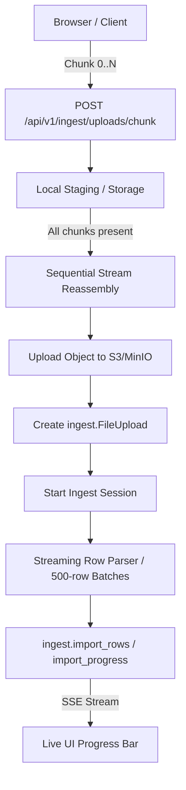

# Module: Ingest (Chunked Import & Streaming Pipeline)

## Overview & Scope (Plan V5 Phase 4)

The `ingest` module provides the robust backend and UI wizard for high-volume catalog onboarding and bulk updates (supporting files with 50,000+ items without memory spikes or connection timeouts).

---

## 1. Legacy Laravel Investigation & Architecture Parity (§4.1.1)

### Laravel Chunking Components
- **Client Transport (`ChunkUploadController.php`):**
  - Uses chunked HTTP multipart uploads.
  - Chunk identification: `file_uuid` (UUID string), `chunk_index` (0-based integer), `total_chunks` (integer), `filename` (string).
  - Storage location: Temporary chunks saved to `chunks/{file_uuid}/chunk_{chunk_index}`.
  - Reassembly: When `count(uploadedChunks) === total_chunks`, streams and concatenates files chunk-by-chunk using a 4KB buffer (`fread`/`fwrite`) directly to final storage, avoiding memory overhead.
  - Cleanup: Deletes the temporary `chunks/{file_uuid}` directory immediately following reassembly.
- **Spreadsheet Streaming (`ChunkReadFilter.php`):**
  - Implements PhpSpreadsheet `IReadFilter` (`$startRow`, `$chunkSize`).
  - Reads XLSX in fixed row windows (e.g. 500 rows) instead of loading the entire worksheet into RAM.

---

## 2. Go Chunked Pipeline Architecture

### 2.1 Chunked Upload Endpoints
- `POST /api/v1/ingest/uploads/chunk`:
  - Multipart form: `file` (chunk data), `chunk_index` (int), `total_chunks` (int), `file_uuid` (string), `filename` (string).
  - Stores chunk idempotently. Re-submitting the same chunk index is safe and overwrites without error.
  - When all chunks arrive, streams and uploads to S3/MinIO under tenant prefix `orgs/<orgID>/uploads/<file_uuid>.<ext>`.
  - Returns `{ "completed": true, "upload_id": 123, "public_id": "..." }`.
- `GET /api/v1/ingest/uploads/chunk/status?file_uuid=...`:
  - Returns list of received chunk indices `[0, 1, 2, ...]` to allow resuming an interrupted upload without re-sending completed chunks.

### 2.2 Streaming Spreadsheet Read
- For CSV: `encoding/csv.Reader` processes record-by-record with minimal memory footprint.
- For XLSX: Streaming row iterator (`excelize.Rows`) iterates row-by-row.
- Staged rows are inserted into `ingest.import_rows` in batches of 500 inside transactions.
- Progress updates are written to `ingest.import_progress` at each batch milestone, feeding the SSE event stream.

---

## 3. Server-Driven Wizard State Machine (§4.2)

The UI wizard strictly reflects the server session state:
- **Step 1 (Upload):** Dropzone with chunked transport. Creates `ingest.file_uploads` and `ingest.import_sessions` (`status = 'pending'`).
- **Step 2 (Mapping):** Automatic column detection via Phase 2 `DetectColumns`. User confirms or adjusts mappings (`POST /vendor/ingest/{id}/mapping`).
- **Step 3 (Review & Edit):** Server processes rows into `ingest.import_rows`. Paginated review table with inline editing of failed/unmatched items (`PUT /vendor/ingest/{id}/rows/{rid}`).
- **Step 4 (Commit):** Transactional commit into catalog inventory (`POST /vendor/ingest/{id}/commit`).
- **Resumability:** Accessing `/vendor/ingest/{sessionID}` loads the exact step corresponding to the session's database state.

### Stability and upload ownership (2026-09-30)

- Upload metadata is bound to the authenticated user and current organization. Registered object keys must remain under `orgs/<organizationID>/uploads/`; filenames cannot contain paths. A forged import document can no longer authorize a server-file download or another tenant's object.
- Chunk uploads enforce 10 MB per chunk and 200 MB total before writing. Reassembly streams through a temporary file instead of a whole-file memory buffer. Locks cover one upload, so a slow object-storage request does not block unrelated uploads.
- Completion requires working object storage and a successful metadata write. Storage failures retain all chunks for retry and return an error; chunks are removed only after success. Regression tests cover ordered assembly, failed-storage recovery, cumulative limits and independent uploads.
- Watermarking now uses the same header-first, overflow-safe pixel ceiling as compression and renditions. A valid oversized image header is refused before pixel allocation, covered by a crafted PNG regression fixture.

---

## 4. Product Matching and AI Enhancement

Vendor catalogue onboarding routes identity assignment through the unified product matching architecture (`matching.Service`). The module maintains strict boundary separation: `ingest` never imports `catalog` internal matching types, consuming the capability solely via `ingest.Matcher` (`internal/modules/ingest/matching_port.go`) adapted in the composition root (`cmd/server/ingest_ports.go`).

### 4.1 Matching Service Integration

- **Entry Point & Scope**: Staging initiates via `Matcher.Prepare` with explicit workflow scope (`WorkflowVendor`, `supplier:<orgID>`, and `EffectiveOrg`).
- **Identifier Namespaces**: Column mapping explicitly declares the namespace for identifier fields:
  - Default code column is declared as `supplier_code`, isolating vendor item numbers from master catalogue SKUs unless corroborated by explicit org knowledge or declared as `catalog_code`.
  - Default barcode column is declared as `gtin`.
  - Identifier matches are attributed to reasons `identifier_gtin`, `identifier_supplier_code`, or `identifier_catalog_code`.
- **Primary Decision States**: Every staged row stores a canonical `matchflow.RowDecision` JSON and projects flattened columns via `matchflow.Columns`:
  - Primary states: `accepted`, `confirmed`, `needs_review`, `ambiguous`, `no_candidate`, `unlinked`.
  - `matched_product_id` is set **iff** state is `accepted` or `confirmed`. For any other state, `matched_product_id` is `NULL`.
  - Legacy match levels (`exact`, `barcode`, `code`, `strong`, `review`, `ambiguous`, `none`) are derived strictly as projections from `(state, basis, reasons)` without divergent scoring paths.

### 4.2 Rerun Clearing and Stale Preview Invalidation (FR-041)

- Rerunning preparation or modifying column mappings increments `match_revision` and supersedes previous decisions.
- When a rerun or manual review action (`ClearRowMatches` / unlinking) produces a non-accepted state (`needs_review`, `ambiguous`, `unlinked`), `matched_product_id` and `variant_id` are reset to `NULL`.
- Because downstream stock and price preview (`PreviewCommit`) and commit execution (`StagedRowsForCommit`) require an accepted/confirmed product link, resetting `matched_product_id` and `variant_id` immediately invalidates any stale downstream stock or price mutations for that row.

### 4.3 Commit-Time Revalidation (FR-093)

Before final transactional commit of variant records and warehouse stock balances:
- The importer calls `Matcher.Revalidate` for each staged row.
- Rows are rejected from commit if:
  1. `match_revision` has changed or a `catalog_changed` flag is raised,
  2. the decision state is no longer `accepted` or `confirmed`, or
  3. the achieved granularity is below `pack` (`revalDec.Granularity.Achieved != matchflow.GranularityPack`).
- Rejected rows are recorded as skipped (`OutcomeSkipped`) with explanatory messages and prominently reported in the commit summary notice (`commitNotice`).

### 4.4 AI-Off Deterministic Operation (FR-059, FR-114)

- **Deterministic Baseline**: Deterministic matching is the source of truth and operates autonomously with zero AI dependency. A vendor can import, review, and commit with AI completely disabled or when the AI Gateway is unconfigured/unreachable.
- **AI-Off Execution Path**: When `Settings.UseAI` is false or `AIAvailable()` is false, `stagingRun.enhance` is skipped entirely:
  - 0 Gateway/enhancer network calls are dispatched.
  - Staged rows retain `ai_state = "off"`.
  - No intermediate waiting or enhancing phases are recorded.
  - The import session transitions directly to `reviewable` (`PhaseReview`) upon completion of the deterministic streaming pass.
- **Removal of Legacy Ceilings (FR-114)**: Legacy hardcoded item/request ceiling prose (e.g. 200 items/request, 12 requests/run) and candidate-list cache keys are replaced by the unified policy engine (`matchflow.Policy`) and fingerprint-based scoped knowledge (`catalog.match_knowledge`). AI limits and budgets are configured per active policy and enforced through standard context timeouts and cost reservations without blocking import completion.

